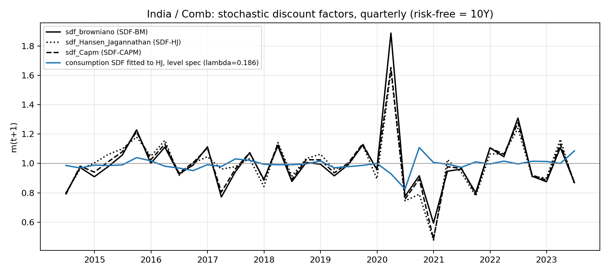
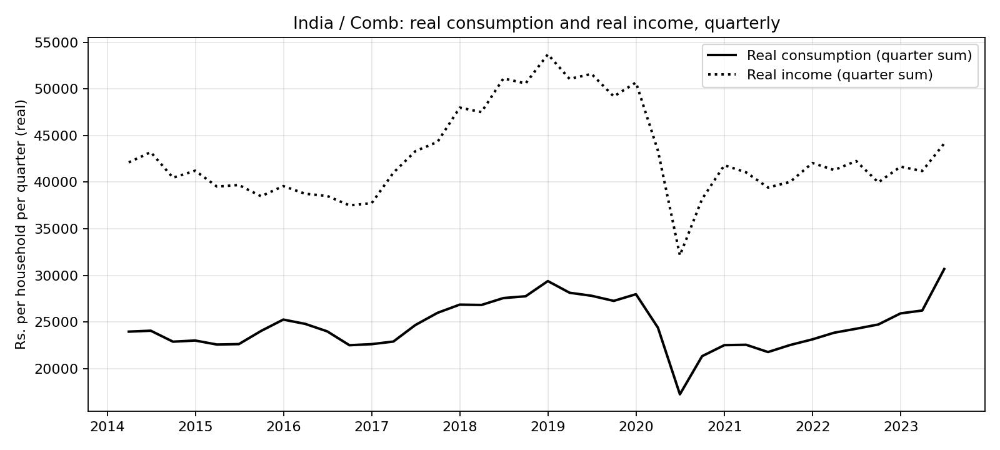

# Consumption-Based Asset Pricing on Indian Household Data (Quarterly)

How risk-averse are Indian households, judging by how their spending moves with market returns?

This project estimates that from household survey data. It builds a quarterly panel of real household spending and income for 24 Indian states and union territories plus all-India, each split into rural, urban and combined (2014Q1–2023Q2). Three market-based stochastic discount factors (SDFs) come from real Sensex and real 10-year government bond returns. The project then asks what values of patience (β) and risk aversion (γ) make a standard consumption model (CRRA utility) match those discount factors. Each group is estimated twice: once with ordinary consumption, and once allowing for rule-of-thumb households that simply spend a share of their current income (Weber, 2000).

---

## Main findings

- **Risk aversion comes out negative.** Across all 876 estimated fits (74 groups × 3 SDFs × 2 specifications × with and without rule-of-thumb households), γ is negative in about 90% of cases and **never significantly positive**. Indian household spending does not move in the way the standard model needs to explain stock-market risk.
- **Patience looks normal.** The quarterly discount factor β sits around 0.98–0.99, which is economically sensible.
- **The model is not rejected, but that says little.** The Hansen J-test almost never rejects the moment conditions (under 1% of fits). With only about 36 quarters per group, the test has little power.
- **Rule-of-thumb households help only a little.** Removing the spend-as-you-earn share makes rural estimates more precise, but γ stays negative.
- **The Weber (2000) λ is mostly unidentified.** When λ is estimated directly by GMM, it cannot be pinned down in 20 of 24 specifications. In the fitted equations, the term containing λ collapses to a constant, so any value of λ fits equally well (see `WEBER_LAMBDA_SUMMARY.txt`).

All-India estimates (Hansen–Jagannathan SDF, level specification; standard errors in brackets):

| Region   | γ with λ = 0      | λ used | γ with λ     | β (λ = 0) |
|----------|-------------------|--------|--------------|-----------|
| Combined | −0.47 (0.72)      | 0.186  | −0.49 (0.73) | 0.990     |
| Rural    | −0.89 (0.65)      | 0.285  | −0.51 (0.26) | 0.986     |
| Urban    | −0.77 (0.63)      | 0.140  | −0.83 (0.75) | 0.988     |

---

## Figures

**Why the model struggles.** The market-based SDFs (black) swing widely from quarter to quarter, especially around the COVID crash in 2020. The SDF implied by household consumption (blue) stays close to 1, because spending moves far too little to match them.



**The raw data.** All-India real household spending and income per quarter. Spending is much smoother than income, apart from the 2020 lockdown drop.



Plots for every state × region are in `SDF_quarterly_lambda_results/figures_all_cells_Q.pdf`.

---

## Method in brief

**1. Data (quarterly, real terms)**
- **Consumption C:** total household spending, summed over the three months of each quarter.
- **Income Y:** total household income deflated by state-level CPI, summed over the quarter.
- **Market return:** real BSE Sensex return over the quarter.
- **Risk-free return:** real return on the 10-year government bond.

**2. Market-based SDFs**, built from the two returns only, so they are the same whatever λ is:
- **Hansen–Jagannathan (HJ):** the minimum-variance SDF that prices both assets exactly.
- **CAPM:** an SDF linear in the market return, fitted to price both assets.
- **Lognormal (BM):** the SDF implied by a geometric Brownian motion for the market.

**3. CRRA estimation by two-step GMM.** For each group and each SDF:
- Spending adjusted for rule-of-thumb households is S = C − λY. With λ = 0, S is just consumption.
- **Level specification:** m(t+1) = β · (S(t+1)/S(t))^(−γ)
- **Log specification:** ln m(t+1) = ln β − γ · Δln S(t+1)
- **Instruments:** a constant, lagged consumption growth and the lagged SDF.
- **Weighting:** Newey–West.
- **Optimiser:** L-BFGS-B from several starting points, then a Nelder–Mead polish.
- **Bounds:** β ∈ [0.5, 1.5], γ ∈ [−50, 50].

**4. Feasibility of λ.** S = C − λY has to stay positive in every quarter. If it doesn't, the group is reported as infeasible and is not estimated; the λ value itself is never changed. λ is feasible in 72 of 74 groups. The exceptions are rural Madhya Pradesh and rural Punjab.

**5. Built-in checks**, run at the end of every run:
- The HJ and CAPM SDFs price both assets exactly in every group.
- The HJ series is re-derived independently from the raw panel.
- The log specification is linear, so its GMM estimate is recomputed in closed form and compared with the optimiser's answer (146 fits agree to about 1e-5).
- Every feasible fit converged.

---

## Repository layout

| File | What it is |
|------|------------|
| `main.py` | The full pipeline: SDFs, CRRA estimation by GMM, figures and checks |
| `CONSUMPTION_INCOME_Q.csv` | **Main input.** Quarterly panel of spending, real income, real Sensex return and real 10-year bond return for each state × region |
| `Lambda_Average_Values_For_Each_Region.csv` | **Main input.** One rule-of-thumb share λ for each state × region |
| `Consumption.csv` | Monthly household spending by category (raw input to the panel) |
| `REAL_INCOME_FINAL.csv` | Monthly household income, nominal and CPI-deflated |
| `CPI.csv` | Monthly state-level CPI, overall and by category |
| `T-BILL.csv` | Monthly 10-year bond and Treasury bill yields |
| `REAL_RETURNS_QUARTERLY_3M.csv` | Quarterly real returns on the Sensex and sector indices |
| `RISK_FREE_REAL_QUARTERLY.csv` | Quarterly real risk-free returns (10-year and 364-day) |
| `WEBER_LAMBDA_RESULTS.csv`, `WEBER_LAMBDA_GIVEN_ALPHA.csv`, `WEBER_LAMBDA_SUMMARY.txt` | Results of estimating λ directly with Weber's (2000) equations, including the identification diagnostics |
| `SDF_quarterly_lambda_results/` | Output of `main.py` (see below) |

### Columns used from `CONSUMPTION_INCOME_Q.csv`

| Column | Meaning |
|--------|---------|
| `STATE`, `REGION` | State (or `India`) and region (`Comb`, `RURAL`, `URBAN`) |
| `QUARTER` | Calendar quarter, e.g. `2014Q1` |
| `TOTEXP_Q` | Real household spending, summed over the quarter |
| `REAL_TOT_INC_Q` | Real household income, summed over the quarter |
| `SENSEX_REAL_Q` | Real Sensex return over the quarter (net, so 0.05 = 5%) |
| `RF_REAL_10Y_LOG` | Real 10-year bond return over the quarter (log) |

---

## How to run

```bash
pip install numpy pandas scipy matplotlib
python main.py
```

The script looks for the two main input files next to itself, then in the folder you run it from. You can also give the paths yourself:

```bash
python main.py --panel path/to/CONSUMPTION_INCOME_Q.csv \
               --lam   path/to/Lambda_Average_Values_For_Each_Region.csv \
               --out   path/to/results
```

A run takes about 1–2 minutes. It ends by printing `verification PASSED` or `FAILED`.

---

## Outputs (`SDF_quarterly_lambda_results/`)

| File | Contents |
|------|----------|
| `CCAPM_ESTIMATES_Q.csv` | β and γ with standard errors, J-test and convergence flags, for every group × λ choice × SDF × specification |
| `SDF_STATS_Q.csv` | Summary statistics for the HJ, BM and CAPM SDFs in each group, and whether they price both assets |
| `SDF_SERIES_Q.csv` | Quarter-by-quarter values of the three SDFs |
| `CONSUMPTION_SDF_STATS_Q.csv` | How closely the fitted consumption SDF tracks each market SDF (correlation, RMSE) |
| `CONSUMPTION_SDF_SERIES_Q.csv` | Quarter-by-quarter fitted consumption SDF next to the target SDF |
| `LAMBDA_FEASIBILITY_Q.csv` | Whether C − λY stays positive in every quarter, for each group |
| `fig1_consumption_income_India_Q.png` | All-India real spending and income |
| `fig2_sdf_India_Q.png` | All-India SDFs, with the fitted consumption SDF |
| `figures_all_cells_Q.pdf` | The same two plots for every state × region |
| `run_log.txt` | Full console log, including the verification results |

---

## Limitations

- The sample is short (37 return quarters per group), so standard errors are wide and the J-test has little power.
- Spending and income are household survey averages, which are much smoother than the returns they are asked to explain.
- The market side uses one equity index and one bond. Adding sector indices (already in `REAL_RETURNS_QUARTERLY_3M.csv`) is a natural next step.

---

## References

- Hansen, L. P. & Jagannathan, R. (1991). Implications of security market data for models of dynamic economies. *Journal of Political Economy*, 99(2), 225–262.
- Hansen, L. P. & Singleton, K. J. (1982). Generalized instrumental variables estimation of nonlinear rational expectations models. *Econometrica*, 50(5), 1269–1286.
- Weber, C. E. (2000). "Rule-of-thumb" consumption, intertemporal substitution, and risk aversion. *Journal of Business & Economic Statistics*, 18(4), 497–502.
- Monteiro, M. S. & Carrasco-Gutierrez, C. E. (2022). Testing the consumption-based CAPM using the stochastic discount factor. *Revista Brasileira de Economia*, 76(1). doi:10.5935/0034-7140.20220004. (The HJ, BM and CAPM SDF estimators used here follow this paper.)

---

## License

This project is for academic and educational purposes.

---

## Author

**Mudigonda Omkaar Sharma**  
B.Tech Electrical Engineering, Nirma University  
Research Interests: Asset-Pricing, Financial Economics, Energy Markets, Stochastic Processes

[LinkedIn](https://www.linkedin.com/in/omkaar-sharma-b2b179200/) · [GitHub](https://github.com/Musashi1970)

*Independent research project in energy market stochastic modelling.*
